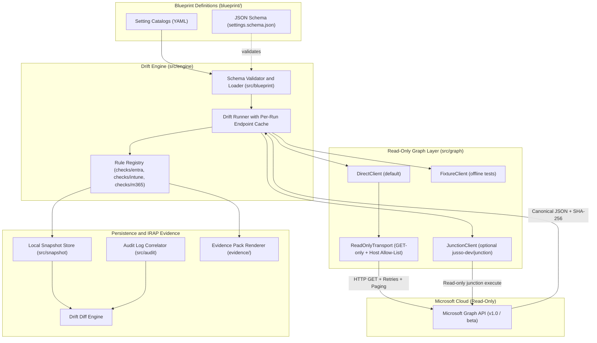
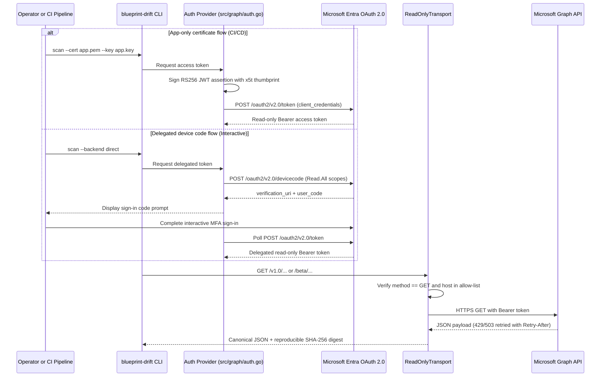
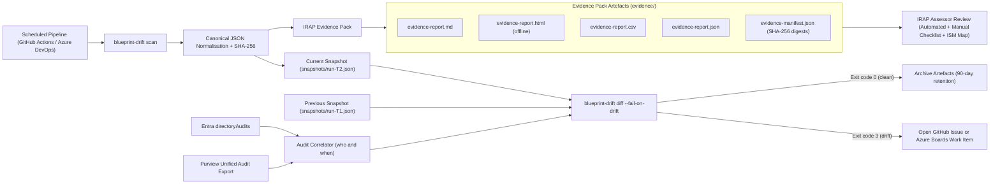

# Architecture Diagrams

This document illustrates the `blueprint-drift` drift engine, read-only authentication flows and IRAP evidence pipeline using GitHub-compatible Mermaid diagrams.

> **Disclaimer:** This is an independent community project. It is not produced, endorsed or supported by the Australian Signals Directorate (ASD), the Australian Cyber Security Centre (ACSC) or Microsoft.

## 1. Drift engine and read-only collection architecture

## 2. Authentication and least-privilege read-only flow

`blueprint-drift` supports app-only X.509 certificate credentials ([Microsoft identity platform certificate credentials](https://learn.microsoft.com/en-us/entra/identity-platform/certificate-credentials)), interactive delegated device code flow ([Microsoft identity platform device code flow](https://learn.microsoft.com/en-us/entra/identity-platform/v2-oauth2-device-code)), and optional delegation to [jusso-dev/junction](https://github.com/jusso-dev/junction).

## 3. Evidence pack and continuous drift pipeline flow

This flow aligns snapshot storage, drift attribution and tamper-evident report generation for an [IRAP](https://www.cyber.gov.au/resources-business-and-government/assessment-and-assurance/irap) assessment against the [ASD Blueprint for Secure Cloud](https://blueprint.asd.gov.au/) and [ISM](https://www.cyber.gov.au/resources-business-and-government/essential-cyber-security/ism).

